# Jev-Based Multi-Model Routing: Methodology and Measurements

Measurements taken in October 2026 on open-weight models served by engy.ai.

## Abstract

Our goal is a routing policy that judges the task class from the content of a request and sends each request to the optimal model for that class: the model whose score is not clearly below the best model's, at the lowest possible cost. We built such a task-class router, Auto, which uses Jev to classify requests, in front of several open-weight models from one provider, and measured its score and cost on tasks that played no part in choosing the policy. For each new conversation, Jev picks one of 16 task classes and Auto hands the whole conversation to the model that a fixed policy assigns to that class; in direct-answer classes whose primary model is DS 4.1, a non-streaming request that DS 4.1 leaves without an answer is answered again by Kimi K3; when a conversation outgrows a model's input limit, it switches to a long-context model. The policy was chosen from the results of 6 models on the selection set: 7 public benchmarks (2,939 decision units), the first 1,700 text-only questions of Humanity's Last Exam (HLE) in a fixed random order, and 40 LiveBench plot-unscrambling questions. Effects are measured on three validation sets that took no part in the selection: another 457 HLE questions, 508 held-out LiveBench questions, and 100 τ²-bench telecom tasks not used before. On every validation set, Auto's score and cost are compared with each single model tested, with two main references: Kimi K3, the highest per-token price and the highest score on HLE, and DS 4.1, the lowest per-token price. Scores on the selection set are in-sample and are used only to check that the routing behaves as designed. Total spend was about $1,815.

On the selection set, Jev routed 93.9% of the questions to the model assigned to their class; in the end-to-end runs on the validation sets, the actual routing on HLE and the LiveBench holdout matched the per-question classification made beforehand in every case, and each session made a single routing decision. On all three validation sets, Auto's score is not significantly below Kimi K3's, at 4% to 65% of its cost per question; on no validation set is any single model tested both cheaper and higher-scoring than Auto. On HLE, Auto's accuracy is 36.5%, not significantly different from Kimi K3's 38.3% (−1.8, 95% confidence interval −5.7 to +2.4), at 53% of its cost per question, and 6.3 points above DS 4.1 (+2.6 to +10.1) at about 42 times its cost. On the LiveBench holdout, Auto scores 87.4, with no significant differences from Kimi K3, DS 4.1 and Qwen, the highest-scoring model on this set (87.6), at 4% of Kimi K3's cost per question. On the telecom tasks every model except Kimi K3 is close to full marks, so the set discriminates little: Auto passes all of them, as do GLM-5.3, GLM-Flash and DS 0731, the last two at about 1/7 and 1/19 of Auto's cost per task; DS 4.1 and Kimi K3 pass 99% and 85%, and Kimi K3 costs 1.5 times as much per task as Auto. The equal-weight average of the three validation sets is in Section 7.4.

Interpretation, product implications and pricing are outside the scope of this document.

## 1. Problem Statement

Consider a catalog of open-weight models served by a single provider at published per-token prices, and let a task be scored by its official grader, which the models cannot read. The models are good at different tasks and their prices differ widely, so every request has an optimal model: one whose score on that kind of task is not clearly below the best model's, at the lowest possible cost. We look for a routing policy that sends each request, from its content, to its optimal model as often as possible, and test it on tasks that played no part in choosing the policy:

1. How does Auto's score compare with each single model?
2. What is Auto's cost relative to each single model, and is there a single model that is both cheaper and higher-scoring than Auto? Cost is the provider's own token billing.

Section 7 answers both questions for each validation set. Kimi K3, the highest per-token price and the highest score on HLE, and DS 4.1, the lowest per-token price, serve as the two main references below; the highest-scoring single model on each validation set is listed in Section 7. These comparisons also require that the router actually behaves as designed; Section 6 checks this, and scores on the selection set are not evidence of effect.

This document does not cover model merging at training time, cascades or verifiers that decide on escalation from answer quality (the handoff in Section 2.5 only checks whether an answer was given, not whether it is correct), image and audio inputs, closed-weight models, or multiple samples per question.

## 2. System Design

### 2.1 Decision model

Routing by task class requires deciding, before any model answers, which class a conversation belongs to. The models have different strengths and, on the same benchmark, their cost per question differs by about 12 to 100 times (Section 5.1), while a request does not state its task type; the same subject can also fall into different classes: among math problems, writing a proof goes to Kimi K3, while a problem that only needs a final answer goes to DS 4.1. This decision can only be made from the content of the request. Jev makes it, choosing a model for each conversation on the user's behalf. On the selection set it routed 93.9% of the questions to the model of their class (Section 6.1); a Jev call costs about $0.0001, about 0.1%, 9% and 0.5% of Auto's cost per question on HLE, the LiveBench holdout and the telecom tasks respectively.

Jev is a decision model provided by TypeSafe AI. For each new conversation, Auto asks Jev to choose one of 16 task classes. The classes have two levels: tasks that need multi-step interaction with tools or an environment go to the 4 agent classes, and all other tasks go to the 12 direct-answer classes; the subject matter does not affect this level. Direct-answer classes are split by the form and difficulty of the answer: math into writing a proof and giving a final answer; physics, chemistry and engineering into graduate level or harder and undergraduate level or easier, with biology and medicine in the latter; text tasks into transforming a supplied text and reordering a long text. Long requests are first compressed into a compact view that keeps only the instructions, the beginning and end of long texts, and the tool descriptions before they are sent to Jev; the selected model always receives the original request.

### 2.2 Policy

We evaluate 6 models and use these short names: deepseek-v4.1-flash (DS 4.1), deepseek-v4-flash-0731 (DS 0731), kimi-k3 (Kimi K3), glm-5.3-flash (GLM-Flash), glm-5.3 (GLM-5.3), qwen3.8-27b (Qwen).

**Table 1.** Routing policy. Section 5 gives the basis for each class.

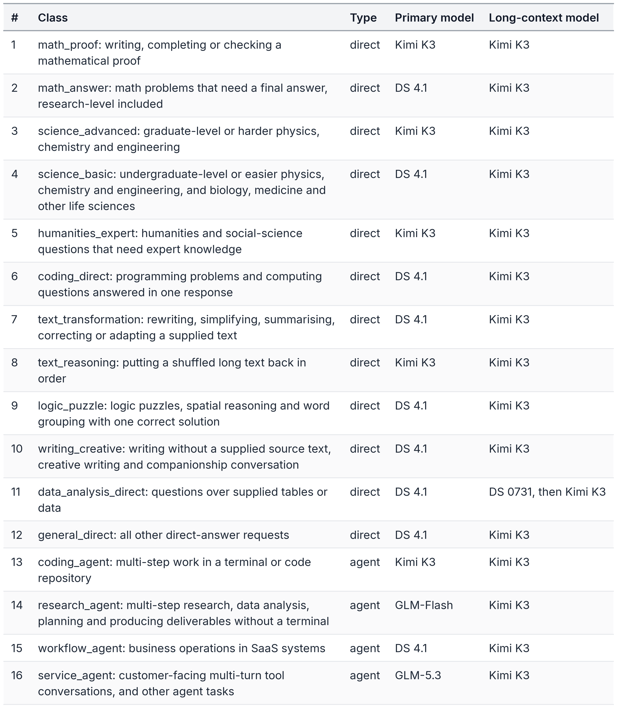

In the 8 direct-answer classes whose primary model is DS 4.1, a reply that gives no answer is answered again by Kimi K3 (Section 2.5). Kimi K3 is the primary model of 5 classes and the long-context model of 15, and the only target of this handoff.

### 2.3 Capacity filter and long-context switching

Each class's primary model, long-context model and any later models form a switching chain. The router counts the request's tokens with a general-purpose tokenizer (OpenAI's o200k), adds a safety margin, compares the result with each model's input limit, and uses the first model in the chain that can hold the request. When a conversation outgrows the current model's limit, it moves down the chain, without reclassification and without moving back. Long requests are also subject to the handoff in Section 2.5: a long table request answered by DS 0731 that gives no answer is answered again by Kimi K3; Kimi K3's input limit is larger than DS 0731's, so it can hold any request DS 0731 can.

### 2.4 Session stickiness

All requests of a session use the same model, which changes only when the conversation outgrows the model's input limit (moving down the switching chain) or after a handoff (Section 2.5), when it moves to Kimi K3. A session is identified by the client's session ID when one is supplied, and otherwise by the first system message and the first user message, which stay the same throughout a conversation because the client resends the full history every turn. Different conversations whose first two messages are identical are identified as one session and share one model until the session expires, including the state of having moved to Kimi K3 after a handoff. A session expires after a period without requests; the next request is classified again.

### 2.5 Request handling

Auto handles two kinds of requests: direct answers (one reply from the model is the answer; the 12 direct-answer classes) and agent tasks (the model calls tools over several turns; the 4 agent classes). A handoff is triggered when all of the following hold: the request belongs to a direct-answer class; the answering model is DS 4.1, or DS 0731 for a long table request; the request is not streamed; and the reply gives no answer, that is, its content is empty (reasoning text alone counts as empty), the output was cut off at the maximum length, or the request still fails after retries on the same model. The same request is then sent once to Kimi K3, the client receives Kimi K3's reply, and later requests of the session also go to Kimi K3. A reply that gives a wrong answer does not trigger a handoff; agent tasks are only retried on the same model and never handed off. All tests in this document use non-streamed requests.

In Auto, every model uses the provider's default sampling parameters: the router removes the temperature and top_p parameters from the requests; reasoning effort follows the request, and was set to the maximum in all experiments in this document. A failed request is first retried on the same model with backoff. Each request writes one log line with the class and the probabilities of all classes, the selected model, every attempt, token counts and cost.

## 3. Experimental Design

### 3.1 Data split

Below, "official" means the evaluation code, configuration and leaderboard rules published by each benchmark's authors.

**Table 2.** Benchmarks and their use. The first 9 rows form the selection set, used to choose the policy; the last 3 rows form the three validation sets, whose results are not used to change the policy.

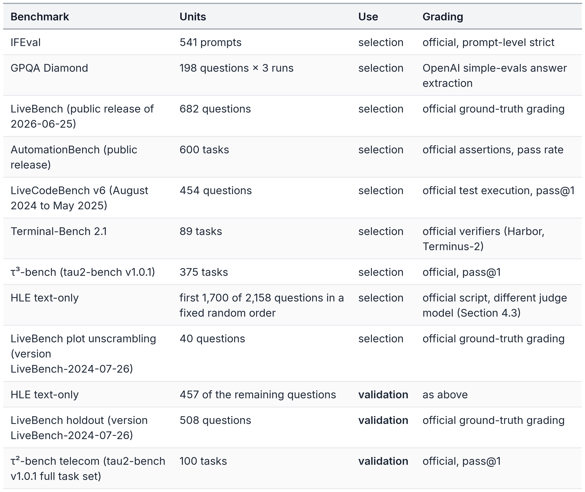

All arms answer the 2,158 text-only HLE questions in one shared random order (seed 20261010); the first 1,700 questions are used for selection. Among the remaining questions, DS 4.1's answer to one could not be graded and that question is left out; the other 457 are used for validation.

The LiveBench holdout consists of retired questions from LiveBench's public data that are not among the 682 selection questions and are not similar to any of them, 548 in all; 40 plot-unscrambling questions among them are used to choose the model for long-text reordering and belong to the selection set, and the other 508 are used for validation. These questions were published in 2024 and may be in the models' training data.

The τ²-bench telecom validation set comes from the full telecom task set of tau2-bench v1.0.1 (2,285 tasks). Removing the 114 base tasks used in the τ³-bench selection runs, we sampled 200 tasks with seed 20261012 and ran the first 100 in sampling order. These tasks use the same policy and tools as the telecom tasks in the selection set, and their user scenarios all appear among the base tasks; they differ in the combination of faults to troubleshoot and in the user persona, and none was used in any earlier test.

### 3.2 Models and settings

We evaluate the 6 models listed in Section 2.2. All requests go through the same provider with reasoning effort set to the maximum, and each question's result comes from one run (GPQA is the mean of 3 runs). All results are measured under engy.ai's serving configuration, including each model's maximum output length; an answer that exceeds the maximum output length counts as a failure, as in official grading; agent tasks run under the official time limits. Absolute scores therefore reflect performance under that configuration and should not be compared directly with results published by model makers or other providers.

The models under test use the provider's default sampling parameters, with these exceptions: Terminal-Bench 2.1 keeps the temperature of 1.0 that its maintainers set for Terminus-2 in the leaderboard configuration; the single-model τ³ runs pass temperature 0, the tau2-bench default, except that Kimi K3, DS 0731 and GLM-Flash use the provider's default sampling in the banking domain; the router removes the temperature and top_p parameters from Auto's requests, so the selected models use the provider's default sampling. Every evaluation step that needs a model uses one that is not being compared: the user simulator of τ³ and the telecom tasks and τ³'s natural-language assertion grading use glm-5.2 at temperature 0 (the official leaderboard uses gpt-5.2 and gpt-4.1 respectively), and for assertion grading we only relaxed the parsing of the grader's output format, leaving the prompt and grading logic unchanged; banking's knowledge retrieval uses BM25 only (officially a combination of BM25, vector search and shell), so τ³'s absolute scores should not be compared directly with the official leaderboard; the telecom tasks have no natural-language assertions; HLE is graded by glm-5.2 with thinking off, and answers on which glm-5.2 gives no verdict are graded by qwen3.6-35b-a3b (Section 4.3).

### 3.3 Selection rule

Classes are first defined by the form of the task, and we then check whether difficulty changes the optimal model. Of all selection data with official difficulty labels, only science shows a change: on the 66 GPQA physics and chemistry questions their writers rated graduate level or harder, Kimi K3 is 8.1 points higher than DS 4.1 (+3.5 to +14.1), while on the other 132 (the remaining physics and chemistry questions and all biology questions) the two differ by only 1.3 points (−1.3 to +3.8). On the three difficulty levels of LiveCodeBench and of Terminal-Bench 2.1, the optimal model does not change with difficulty. Physics, chemistry and engineering are therefore split into two classes by difficulty, and there is no global difficulty level.

Within a class, questions are pooled and the highest-scoring model is found; a cheaper model is chosen instead unless it is clearly worse, that is, unless the 95% confidence interval of the paired per-question difference excludes 0. Kimi K3 is thus used only in classes where it is clearly better. For direct-answer classes whose primary model is DS 4.1, the comparison uses "DS 4.1 first, Kimi K3 when DS 4.1 gives no answer". In τ³-bench, 45 banking conversations exceed DS 4.1's input limit (DS 4.1 did not finish 3 of them, which are not part of any comparison); these tasks are also used to choose the long-context model (Section 5.2). Research agents, which the 7 public benchmarks do not cover, are filled in from our earlier tests on AgenticDataBench and TravelPlanner and from the public GDPval-AA leaderboard, and the long-context models from long-context questions in LongBench v2, LooGLE and Oolong-real and from the public AA-LCR leaderboard; see Table 3.

### 3.4 Metrics and statistics

Accuracy follows each benchmark's official grading (some LiveBench tasks give partial credit, and Section 7.2 calls the result a score; telecom uses the pass rate); agent tasks are also called questions where the difference does not matter. Cost per question is the provider's charge for all requests needed to complete the question, including reasoning tokens; Auto's cost per question also includes the Jev call and, after a handoff, both answers. τ³-bench's cost per task includes the simulated customer; on the telecom validation set only the side of the model under test is counted, since the user simulator is the same for every arm and costs about $0.03 per task.

On the validation sets we report paired differences, Auto minus each control, computed on the same set of questions, with 95% confidence intervals from 5,000 bootstrap resamples of questions; for the equal-weight average of the three validation sets, each set is resampled separately. These intervals cannot fully reflect the variation between repeated runs of the same model, so differences of a few points should be read with care (Section 4.2). Differences and cost multiples in the text are computed from unrounded values and can differ slightly from values computed from the rounded numbers in the figures and tables.

Conclusions on the validation sets follow one rule: when the 95% confidence interval of a difference excludes 0, we report Auto as higher or lower than the control; when it includes 0, we report the difference as not significant and give the difference and its confidence interval. Whatever the direction, results are reported together with the split by route (HLE in Section 7.1).

### 3.5 Controls

On the three validation sets, every single model shown in Figures 3 to 5 is a control arm, answering the same questions as Auto under the same evaluation settings (sampling settings in Section 3.2).

## 4. Threats to Validity

### 4.1 In-sample selection

The policy was chosen on the selection set, so the chosen models' results there include noise in their favour, and the policy-based estimate on the selection set is optimistic. HLE points the same way: on the first 1,700 questions used for selection, simulated Auto differs from Kimi K3 by −0.5 points (Section 6.2); on the 457 validation questions, the same estimate differs by −1.1 points and the measured result by −1.8 points (Sections 6.3 and 7.1), all within the noise. No selection-set score is used as evidence of effect.

### 4.2 Noise floor

The study has few repeated runs, so noise can only be estimated roughly: on GPQA, each model ran 3 times and single-run accuracy varied by 1.0 to 2.5 points; when Jev classifies the same questions twice, about 0.3% are routed differently. Classes of 20 to 150 questions in the selection set can therefore only resolve differences of several points, and differences of a few points on the validation sets should be read within this range of variation.

### 4.3 HLE judge substitution

HLE is graded by glm-5.2 with thinking off instead of the official o3-mini. The HLE judge, τ³'s user simulator and τ³'s natural-language assertion grading all use glm-5.2, from the same GLM family as GLM-5.3 and GLM-Flash under test. We made two checks. First, glm-5.2 regraded 88 Kimi K3 answers previously graded by GLM-5.3, and the two agree on 79 of the 82 answers on which both gave a verdict; both judges are GLM models, so this check only tests consistency, and the second check tests for a bias towards GLM. Second, 513 text-only HLE questions are multiple choice with a single-letter reference answer, so they can be scored by exact match without a judge: across arms, 2,975 multiple-choice answers have a readable option letter, and on 2,968 of them (99.8%) the judge agrees with exact match; for GLM-5.3 and GLM-Flash it is 99.5% each, and in both arms the disagreements are one lenient and one strict verdict, so on multiple-choice questions we see no judge bias towards GLM. Grading a multiple-choice answer is little more than matching a letter, so this check has limited power for judge bias on free-form answers; this check and the count of empty answers below use each arm's earlier answers to all 2,158 questions (the Auto arm comes from an earlier full run of the router), not only the 457 validation questions. The effect of the user simulator of τ³ and the telecom tasks on the GLM arms was not tested separately.

The checks also showed that when an answer is empty (the output reached the maximum output length before giving an answer), the judge sometimes marks it correct by copying the reference answer; across arms, 172 empty answers were marked correct this way. An empty answer gives no answer, so we score it as incorrect regardless of the judge, with the same rule for every arm. glm-5.2 did not always return a structured verdict on the first attempt, so each arm was graded 3 to 4 times; answers still without a verdict were graded by qwen3.6-35b-a3b, and any still without a verdict count as incorrect; among the 457 validation questions, only Auto has one answer that ended without a verdict (a multiple-choice question answered D, with reference answer A). HLE absolute accuracy may therefore differ from published results, but every paired difference in this study uses the same grading procedure.

### 4.4 Coverage

By Jev's classification, the validation sets cover these classes: HLE mainly covers final-answer math (219 questions), graduate-level science (78), undergraduate science and biomedicine (64), expert humanities (46), general questions (22), logic puzzles (18) and direct coding (8); the LiveBench holdout covers text transformation (245), direct coding (128), logic puzzles (100) and math (33 final-answer, 2 proof questions); the telecom tasks cover service agents (100). The direct-answer classes for long-text reordering, writing and table analysis, and the coding and workflow agent classes, have no validation questions, and research agents have only 2 HLE questions classified as such, so their choices rest only on the evidence used for selection (for research agents, the earlier tests and public leaderboard in Table 3); on the telecom tasks every model except Kimi K3 is close to full marks, so they have limited power for the service-agent choice as well.

## 5. Selection-Set Results

### 5.1 Single-model baselines

**Figure 1.** Accuracy (%, above each bar) and cost per question (USD, below each bar) on each benchmark. τ³ accuracy is over the 330 tasks without the 45 long conversations, and its cost is the mean over all tasks of each model; GPQA is the mean of 3 runs; LiveBench uses the official weighting. DS 0731's AutomationBench score is lowered by a not-yet-fixed problem in the official evaluation code, by at most about 4 points; this does not change the choice for that class. DS 0731 was not run on plot unscrambling. The figures use the models' full names; Section 2.2 gives the short names.

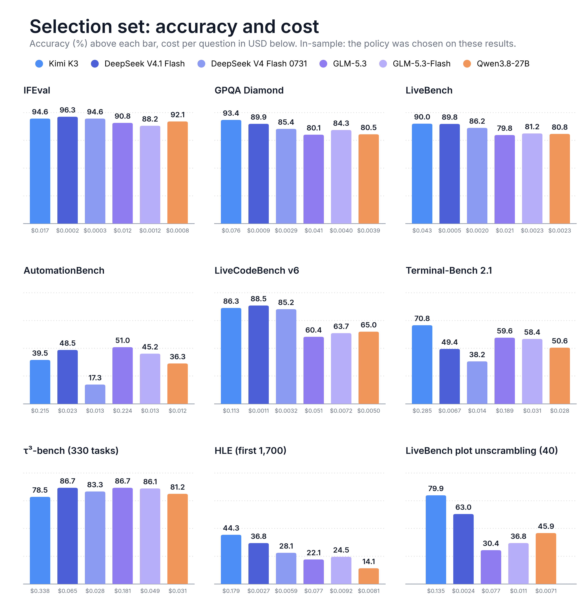

Kimi K3 scores highest on 5 of the 9 benchmarks but does not score highest on IFEval, LiveCodeBench, AutomationBench and τ³; on the same benchmark the most expensive model costs about 12 to 100 times as much per question as the cheapest. Different strengths and very different prices are the premise of routing by task class.

### 5.2 Basis for each class

**Table 3.** Basis for each class. Pooled accuracy is computed over the questions each class contains; differences are followed by their 95% confidence intervals. "With handoff" means DS 4.1 first, Kimi K3 when DS 4.1 gives no answer.

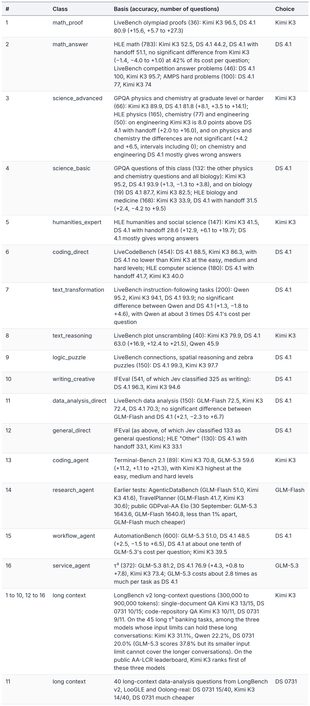

The last two rows of Table 3 are the basis for the long-context models: Kimi K3 for every class except class 11, which uses DS 0731.

The handoff for direct-answer classes (Section 2.5) follows from how DS 4.1 fails on hard questions. On the first 1,700 HLE questions, DS 4.1 gave an empty answer on 232, reaching the maximum output length without an answer; Kimi K3 answering again catches this kind of failure, and with the handoff the difference between DS 4.1 and Kimi K3 on math is not significant, at 42% of Kimi K3's cost. On humanities, chemistry and engineering, DS 4.1 mostly gives wrong answers, which a handoff cannot catch, so expert humanities and graduate-level science go to Kimi K3 directly. The handoff adds little cost: each request is answered at most one extra time, and the failed DS 4.1 attempts cost less than 1% of the total on HLE; the main price is waiting for a second answer on these questions. DS 0731 would not work as a handoff target either: it often gives no answer on the questions where DS 4.1 gives none.

Agent classes have no "switch to Kimi K3 after a number of errors" rule. In the τ³, Terminal-Bench 2.1 and AutomationBench run logs, no count of consecutive errors separates sessions that end in failure from sessions that succeed: on customer-service tasks the cheaper models almost never fail repeatedly, on business-workflow tasks most tool errors are normal probing, and on both kinds of tasks Kimi K3 itself is behind the cheaper models.

## 6. Implementation Consistency

This section checks that the router behaves as designed; it is not evidence of effect.

### 6.1 Jev classification accuracy

Every selection question has an expected class, labelled from the class definitions and not from model results: by task type for each benchmark, by domain and writer-rated difficulty for GPQA, and by subject for HLE. The prompt was tuned on the selection set, so this accuracy is in-sample. Figure 2 gives the result on the whole selection set.

**Figure 2.** Routing on the selection set. Confusions between classes that share a model count as correct.

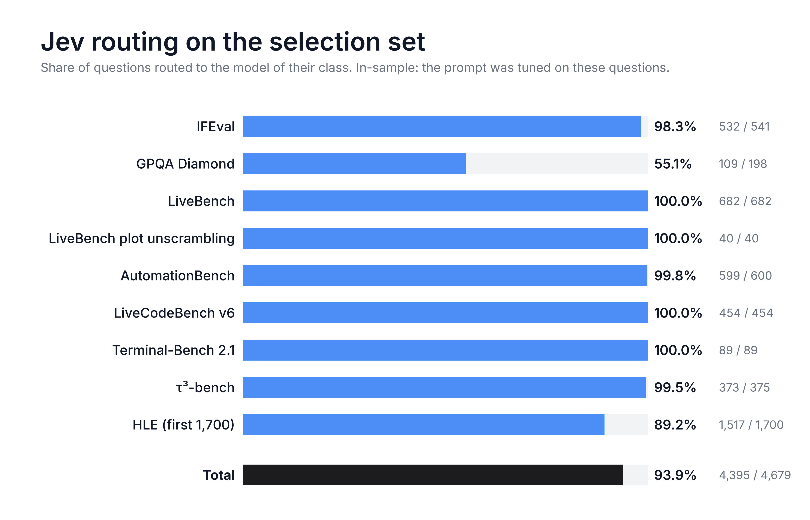

Most routing errors fall on the boundaries of difficulty and subject. Of the 89 GPQA errors, 86 are undergraduate physics and chemistry questions judged graduate level and sent to Kimi K3, with a score difference of about 2 points at a higher cost; the 183 HLE errors go both ways, and the four most common are 38 "Other" questions classified as humanities_expert and 27 math questions classified as science_advanced, which went to Kimi K3, and 26 physics, chemistry and engineering questions classified as science_basic and 16 humanities questions classified as math_answer, which went to DS 4.1.

### 6.2 Simulated Auto

Simulated Auto is an estimate made without running Auto: every question is classified by Jev beforehand, the policy gives the corresponding model, and that model's result and cost on the question are taken from the single-model runs; in direct-answer classes whose primary model is DS 4.1, a question where DS 4.1 gave no answer takes Kimi K3's answer and the cost of both; τ³'s long conversations take the long-context model's result. These are in-sample results (Section 4.1).

**Table 4.** Simulated Auto against Kimi K3 and DS 4.1. In parentheses: cost per question as a share of Kimi K3's; differences are followed by their 95% confidence intervals. LiveBench is the per-question mean, unlike the official weighting in Figure 1; τ³ is all 375 tasks.

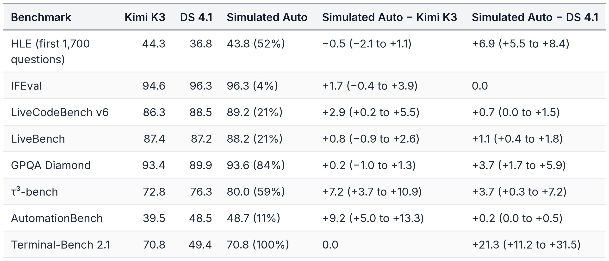

By the rule in Section 3.4, simulated Auto is above Kimi K3 on τ³, AutomationBench and LiveCodeBench, with no significant differences on the other 5; it is above DS 4.1 on HLE, LiveBench, GPQA, τ³ and Terminal-Bench 2.1. The equal-weight average of the 8 rows is 76.3 for simulated Auto, 73.6 for Kimi K3 and 71.6 for DS 4.1. Apart from GPQA and Terminal-Bench 2.1, simulated Auto costs under 60% of Kimi K3 everywhere; GPQA costs more because Jev sends most undergraduate physics and chemistry questions to Kimi K3 as well (Section 6.1). If every GPQA question were routed to its correct class (without handoff), GPQA would be about 92.6 at 50% of Kimi K3's cost; the other rows have few routing errors (Section 6.1).

### 6.3 Routing in the end-to-end runs

The end-to-end runs on the validation sets use the same router and policy as described in this document. On HLE, the actual routing of all 457 questions matched the per-question classification made beforehand (by model); on the LiveBench holdout, 506 of 508 questions went to DS 4.1 and 2 olympiad proofs to Kimi K3, also matching the classification question by question; the 100 telecom tasks formed 75 sessions (25 tasks began with the same first two messages as an earlier task and reused its session), and all 75 classifications were service_agent, sent to GLM-5.3. Each session made a single routing decision, and a client resend of the same question within the session's lifetime kept the session's model. The handoff triggered as designed: of the 331 HLE questions sent to DS 4.1, 63 were answered again by Kimi K3 because DS 4.1 reached the maximum output length without an answer; there were no handoffs on LiveBench or telecom. Every request eventually returned successfully.

The end-to-end results agree with simulated Auto: on the 457 HLE questions the estimate is 37.2% and the measured result 36.5%, a difference of −0.7 points (−4.2 to +3.1); on the 508 LiveBench questions the estimate is 87.0 and the measured result 87.4, a difference of +0.4 points (−1.1 to +1.9), both within the variation between two runs of the same model.

## 7. Validation Results

### 7.1 Humanity's Last Exam (text only, 457 questions)

Kimi K3's accuracy on all 2,158 questions is 43.0%; Artificial Analysis reported 46.9% on 30 September, with a different judge model and harness. The 457 validation questions come from the same random order as the first 1,700 used for selection, and every model scores lower on them: Kimi K3's accuracy drops from 44.3% to 38.3%, and DS 4.1's from 36.8% to 30.2%. Jev classified these 457 questions after the prompt was frozen and routed 88.2% to the model of their class, close to the 89.2% on HLE in the selection set.

**Figure 3.** Accuracy and cost per question of each arm on the HLE validation set (457 questions). Empty answers and answers without a verdict count as incorrect (Section 4.3). Differences from Auto with 95% confidence intervals are given in the text.

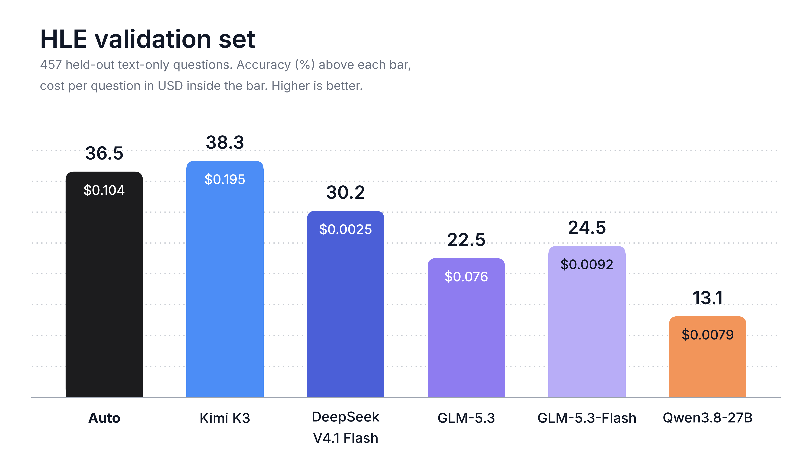

A substantial share of the answers of GLM-5.3, GLM-Flash and Qwen reached the maximum output length before giving an answer and are scored as failures (Section 3.2), so their accuracy is lower here and should not be compared with results published by the model makers.

By the rule in Section 3.4, the difference between Auto and Kimi K3 is not significant (−1.8, −5.7 to +2.4), at 53% of Kimi K3's cost per question; Auto is 6.3 points above DS 4.1 (+2.6 to +10.1) at about 42 times its cost, and above GLM-5.3 (+14.0, +9.8 to +18.2), GLM-Flash (+12.0, +7.9 to +16.2) and Qwen (+23.4, +19.0 to +27.8).

**Table 5.** HLE validation set split by route.

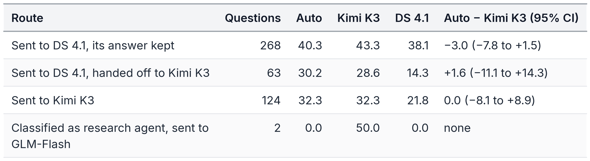

Auto sent 331 questions to DS 4.1, 124 to Kimi K3 (graduate-level science and expert humanities) and 2, classified as research agent, to GLM-Flash. All 63 questions on which DS 4.1 gave no answer were handed off to Kimi K3, which answered 47 of them; on these questions DS 4.1 alone scores only 14.3%, while Auto scores 30.2%, not significantly different from Kimi K3 (+1.6, −11.1 to +14.3), and 15.9 points above DS 4.1 (+3.2 to +28.6). The difference from Kimi K3 comes mainly from questions where DS 4.1 gave a wrong answer: on the 268 questions where DS 4.1's answer was kept, the difference from Kimi K3 is not significant (−3.0, −7.8 to +1.5), but this route has the most questions and contributes most of the overall difference, and a handoff cannot catch this case. Auto gave no answer on 18 questions in the end, all scored as incorrect: on 16, neither DS 4.1 nor Kimi K3 gave an answer, and one question sent directly to Kimi K3 and one sent to GLM-Flash reached the maximum output length.

### 7.2 LiveBench holdout (508 questions)

The 508 questions come from version LiveBench-2024-07-26: 195 instruction following, 50 language, 128 coding, 100 reasoning and 35 math. Jev routed 506 of them to DS 4.1 and 2 olympiad proofs to Kimi K3, so this set mainly tests whether sending text transformation, direct coding, logic puzzles and final-answer math to DS 4.1 holds on new questions. The score is the per-question mean, as on HLE: after removing similar questions the tasks are very unbalanced (only 2 olympiad proofs remain), and with LiveBench's official averaging, first within tasks and then within categories, these 2 questions would carry 10% of the total. Each question keeps its official grade, and some tasks give partial credit between 0 and 1. LiveBench scores on the selection set (Figure 1) use the official weighting and are not directly comparable with the scores in this section.

**Figure 4.** Score and cost per question of each arm on the LiveBench holdout (508 questions). Differences from Auto with 95% confidence intervals are given in the text.

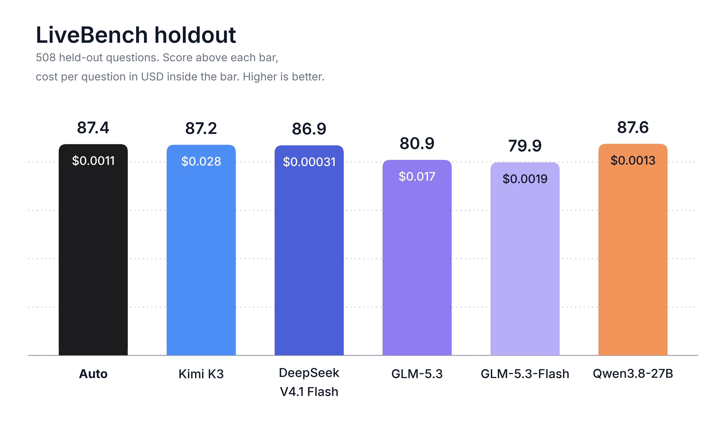

By the rule in Section 3.4, the differences between Auto and Kimi K3 (+0.3, −1.8 to +2.5), DS 4.1 (+0.5, −1.0 to +2.0) and Qwen (−0.1, −2.4 to +2.2) are not significant, and Auto is above GLM-5.3 (+6.5, +3.9 to +9.3) and GLM-Flash (+7.5, +4.7 to +10.3). Auto's cost per question is 4% of Kimi K3's and about 3.4 times DS 4.1's. Almost every question in this set is answered by DS 4.1, so the score difference between Auto and DS 4.1 mainly reflects the variation between two runs of the same model; the cost difference comes mainly from the 2 olympiad proofs sent to Kimi K3 and from the Jev calls (about $0.0001 per question).

### 7.3 τ²-bench telecom (100 tasks)

In the end-to-end run the 100 tasks formed 75 sessions, and Jev classified all of them as service_agent (classifying the 100 tasks one by one beforehand also gave service_agent for all), so Auto sent every task to GLM-5.3, with no long-context switching.

**Figure 5.** Pass rate and cost per task of each arm on the telecom tasks (side of the model under test only). Differences from Auto with 95% confidence intervals are given in the text.

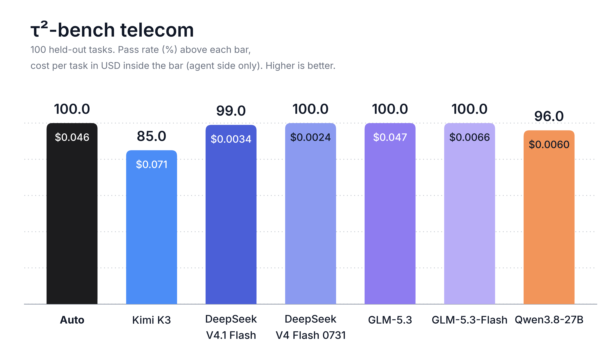

By the rule in Section 3.4, Auto is above Kimi K3 (+15.0, +8.0 to +22.0) and Qwen (+4.0, +1.0 to +8.0), shows no significant difference from DS 4.1 (+1.0, 0.0 to +3.0), and like GLM-5.3, GLM-Flash and DS 0731 passes every task. Auto's cost per task is 65% of Kimi K3's and about 14 times DS 4.1's. Every model except Kimi K3 is close to full marks on this set: all arms pass 80 of the 100 tasks, and no task is failed by all arms. The failures of Kimi K3 and Qwen are all conversations that ended normally with the fault not fixed. This set has limited power for the service-agent choice: GLM-5.3, which Auto uses here, scores about the same as the cheaper DS 4.1, GLM-Flash and DS 0731.

### 7.4 Average of the three validation sets

**Figure 6.** Score and cost per question or task of Auto, Kimi K3 and DS 4.1 on the three validation sets; telecom costs count the side of the model under test only. The equal-weight average is in Figure 7 and the text; the paired differences from Auto are in Sections 7.1 to 7.3.

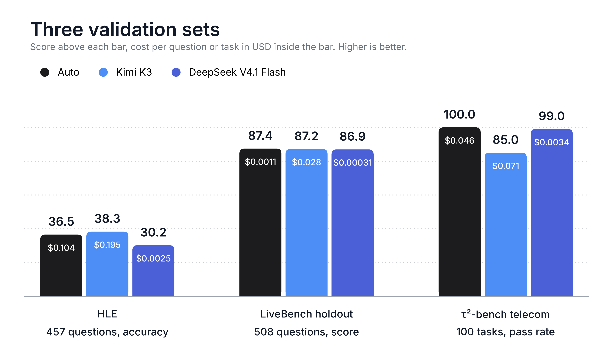

Averaged with equal weight over the three validation sets, Auto scores 74.7 at 41% of Kimi K3's cost per question (the mean of the three per-set shares, as below); Kimi K3 scores 70.2, DS 4.1 72.0 (2% of the cost), GLM-Flash 68.1 (7%), GLM-5.3 67.8 (55%) and Qwen 65.6 (6%). By the rule in Section 3.4, Auto is 4.5 points above Kimi K3 (+1.8 to +7.3) and also 2.6 points above DS 4.1 (+1.2 to +4.1). No single model is both cheaper and higher-scoring than Auto; the Pareto line runs only through DS 4.1 and Auto. On the telecom tasks all arms pass 80 tasks, so the set discriminates little, and Auto's average difference from Kimi K3 comes mainly from this set: without the telecom tasks, averaging HLE and the LiveBench holdout with equal weight, the difference between Auto and Kimi K3 is not significant (−0.7, −3.0 to +1.6), and Auto is 3.4 points above DS 4.1 (+1.5 to +5.5).

**Figure 7.** Equal-weight average score over the three validation sets against cost per question (the values in the text). The horizontal axis is cost per question as a share of Kimi K3's (the mean of the three per-set shares); the dotted line is the Pareto line, joining the arms for which no other arm is both cheaper and higher-scoring; error bars are each arm's own 95% confidence interval for its average score (each set resampled separately by question, 5,000 resamples). Comparisons with Auto rely on the paired differences given in the text; overlapping error bars do not mean there is no difference.

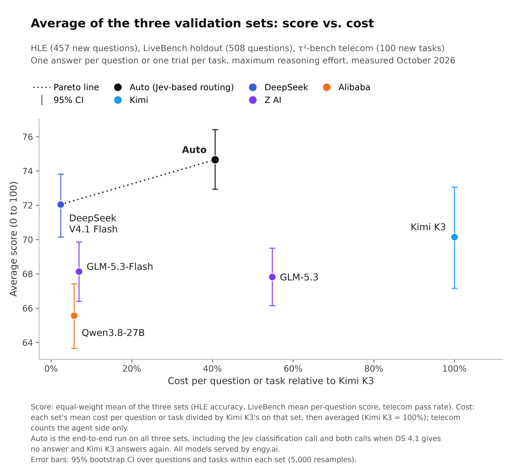

## 8. Reproducibility

**Tools.** The public repository (https://github.com/hanlinai/auto-router) provides a reference implementation of the routing decision (Jev classification, the policy, sessions, the long-context chain and the handoff rule; Section 2) with unit tests, per-question results for every arm (question ID, selected model, score and cost) with scripts that recompute the report's figures, tables and confidence intervals, and the lists of questions drawn from public benchmarks with how they were drawn. Every benchmark was run with its publisher's evaluation code (GPQA with OpenAI's simple-evals); for HLE we added the reasoning-effort setting, relaxed the request timeout, retried failed requests, and added checkpointing and the fixed answer order, identically for all arms.

**Random seeds.** HLE's shared answer order uses seed 20261010, the telecom sample seed 20261012, and the bootstrap seed 20261010.

**Total spend.** About $1,815: about $404 for the single-model runs on the selection set, about $65 for diagnostics and additional tests, and about $1,345 for the validation, end-to-end and other runs (including the judge model and the simulated customer); across all experiments in this document, Jev was called about 23,000 times, at a total cost of about $2.2.

**Not measured.** Multiple samples per question on the validation sets; routing that judges answer quality; cost tiers or user-selectable quality settings; image and audio inputs; closed-weight models; validation evidence for coding, research and workflow agents.

## Appendix: Jev Prompt

The prompt Jev receives, verbatim.

**Preamble.** Classify the user's current task in context into exactly one routing class. Use the conversation context provided in the state to understand the user's actual objective. First decide how the task must be carried out. If completing it requires acting through tools or an external environment over multiple steps (calling tools in a loop, running commands, editing files or a repository, changing records in external systems, or serving an end user over several turns while using tools), choose one of the agent classes (coding_agent, research_agent, workflow_agent, service_agent), whatever the subject matter. If the deliverable can be produced directly as one answer, choose one of the direct classes. Tools may be supplied in the tools field or described in the text (for example a list of tools to call in a Thought/Action loop); both count. Tools being available, or a fact needing to be looked up, is not by itself a reason to choose an agent class. For a direct task, classify by what the answer requires, not by the topic's surface: a physics or chemistry problem stays in a science class even when it needs a calculation, and a question about a specialist field of the humanities stays in humanities_expert even when it is short.

**Question `task_class`.** The routing class of the user's task. Choose the class whose description matches the user's main objective. Agent classes take precedence over direct classes whenever the task needs multi-step interaction with tools or an environment.

- **math_proof.** Direct answer. Writing, completing or checking a mathematical proof: olympiad-style proofs (USAMO/IMO difficulty), filling in the missing steps or expressions of a given proof, or a research-style proof. The deliverable is the argument itself, not just a final value.
- **math_answer.** Direct answer. Mathematics problems whose deliverable is a final answer: calculation, algebra, calculus, word problems, competition problems that ask for a number or expression (AMC/AIME style), and research-level or expert-level mathematics questions that ask for a specific final answer (a value, a formula, a count, a yes/no, or a choice among options). Includes theoretical computer science and statistics questions that are posed as mathematics.
- **science_advanced.** Direct answer. Graduate-level or harder questions in physics, chemistry or engineering that need multi-step expert reasoning or specialist knowledge: for example quantum mechanics, electromagnetism, statistical or condensed-matter physics, thermodynamics, astrophysics, organic reaction mechanisms and synthesis, spectroscopy, physical or inorganic chemistry, materials, circuits, control, structural or chemical engineering analysis. Use this class for expert-level problems in these fields even when they involve calculation.
- **science_basic.** Direct answer. Physics, chemistry or engineering questions at undergraduate level or easier, everyday science questions, and biology, medicine, genetics, ecology, neuroscience or other life-science questions at any level.
- **humanities_expert.** Direct answer. Specialist questions in the humanities and social sciences that need expert-level knowledge to answer: for example linguistics and historical languages, classics, history, philosophy, religion, law, literature, art and music history, archaeology, anthropology, economics or political science at a scholarly level, including obscure facts, readings of specific texts, and exam-style questions written by domain experts. Everyday questions, opinions and casual discussion on these topics belong to general_direct.
- **coding_direct.** Direct answer. Writing code or solving a programming problem in one response (implement a function, solve an algorithmic or competitive-programming problem, complete or fix a given snippet), and questions about computer science, software, machine learning or AI that are answered directly.
- **text_transformation.** Direct answer. The user supplies a piece of text (an article, document or passage) and asks to transform that text: paraphrase or rewrite it, simplify it, summarize it, correct its typos or errors, or adapt it into another form such as a story, while following the given instructions.
- **text_reasoning.** Direct answer. Reasoning over the structure of a long supplied text to reconstruct it: putting shuffled sentences, paragraphs or plot events of a passage back into their correct order, or rebuilding a text's sequence or structure from scrambled parts.
- **logic_puzzle.** Direct answer. Self-contained logic puzzles and word games: zebra or Einstein puzzles, truth-teller and liar puzzles, grid or seating puzzles, spatial reasoning about shapes or positions, grouping words into connected sets, and similar puzzles with one correct solution.
- **writing_creative.** Direct answer. Writing new content without a supplied source text: essays, stories, poems, emails, marketing copy, speeches or other creative writing from a topic or a short seed; and emotionally supportive, empathetic or companionship conversation.
- **data_analysis_direct.** Direct answer over supplied tables or structured data: table question answering, numerical reasoning over a table, column type annotation, joining or reformatting tables, fact checking against a table, and interpreting supplied data to find trends, causes or conclusions. If the task requires running code or tools over data files in multiple steps, choose research_agent.
- **general_direct.** Direct answer for everything else: ordinary conversation and chat, general knowledge and trivia questions, explanations, games and puzzles not covered by logic_puzzle (for example chess positions or riddles), answering questions or extracting information from supplied documents (even long ones), translation, following formatting or length instructions, producing a plan or schedule directly, and choosing a function call with arguments from given function definitions in a single turn.
- **coding_agent.** Agent. Software engineering and any other work done by operating a terminal, sandbox shell or code repository over multiple steps: editing files, fixing bugs, running commands and tests, configuring environments, building, installing or deploying software, and also analysing data, processing files or doing scientific computation in a terminal session where the results are written to files. If the conversation shows a terminal or shell session (for example a command prompt or a working directory such as /app), choose coding_agent whatever the goal.
- **research_agent.** Agent. Multi-step tool use whose goal is a conclusion or a deliverable, without operating a terminal session: searching or browsing for information, analysing data with a code-interpreter or notebook tool to answer a question or produce an output, gathering information with tools to make a plan (for example a travel plan), or producing documents, reports or spreadsheets as deliverables. Work done in a terminal or shell session belongs to coding_agent.
- **workflow_agent.** Agent. Carrying out business operations in software systems: reading and changing records in CRM, HR, finance, marketing, ticketing, email, calendar, spreadsheet, chat or other SaaS tools, possibly across several systems, where the objective is to get the actions done in those systems.
- **service_agent.** Agent. Customer-facing service conversations in which the assistant talks with an end user over multiple turns and uses tools to follow a policy or knowledge base (for example airline, retail, telecom or banking support); multi-turn function calling; using tools to solve a math or science problem; and any other agent task that fits none of the other agent classes.
